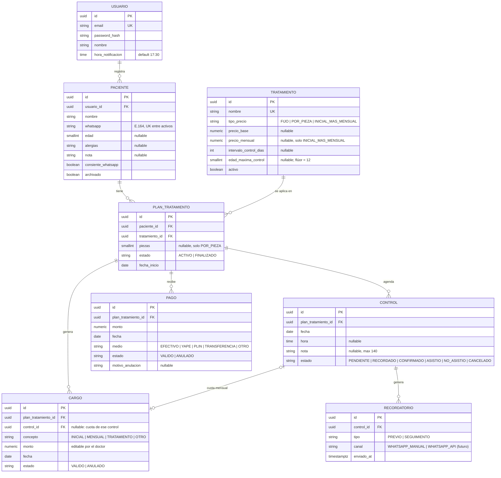
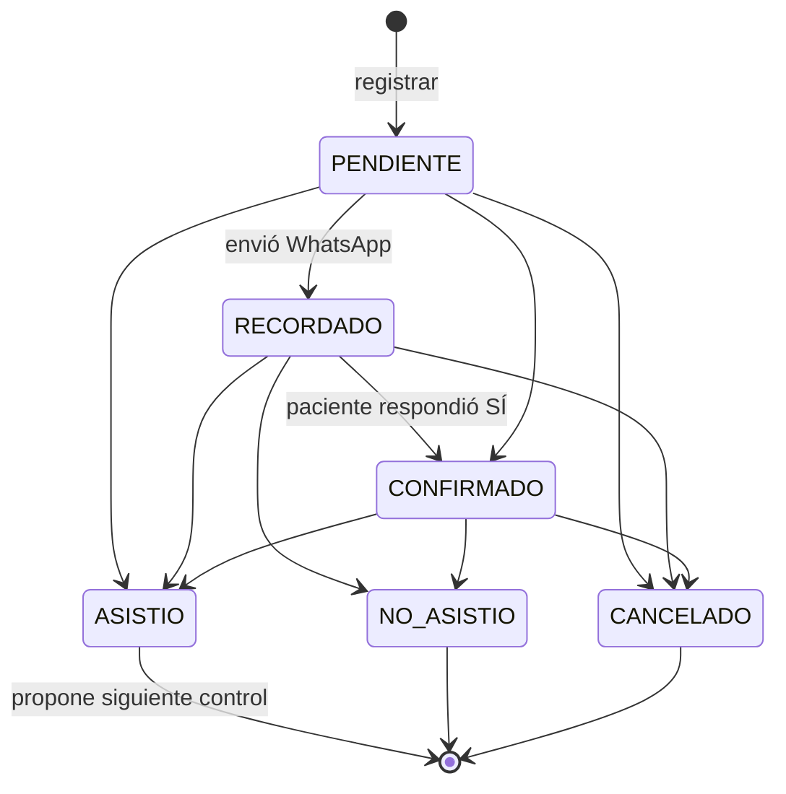

# 03 · Modelo de datos

Base de datos: **PostgreSQL** (Neon). Migraciones versionadas con **Flyway**. Todas las tablas tienen
`id UUID`, `created_at`, `updated_at` (auditoría) y se borran de forma lógica cuando aplica.

## 1. Diagrama entidad–relación

## 2. Por qué existe `PLAN_TRATAMIENTO`

Es la pieza que une **recordatorios** y **deudas** sin pedirle más datos al doctor:

- "Juan · Brackets" es **un** plan. De él cuelgan sus controles mensuales, sus cargos y sus abonos.
- La deuda de Juan = Σ cargos válidos − Σ pagos válidos de todos sus planes. Nunca se guarda: se calcula.

## 2.1 Por qué existe `CARGO` (y no un "costo total")

El consultorio cobra de tres formas (ver [08-catalogo-tratamientos.md](08-catalogo-tratamientos.md)), y en
brackets el total **no se conoce al inicio**: depende de cuántos meses dure. Por eso la deuda es un libro de
movimientos (cargos − pagos), generados automáticamente:

| Evento | Cargo automático (monto editable) |
|---|---|
| Se crea un plan `FIJO` | `TRATAMIENTO` = precio_base |
| Se crea un plan `POR_PIEZA` | `TRATAMIENTO` = precio_base × piezas |
| Se crea un plan `INICIAL_MAS_MENSUAL` | `INICIAL` = precio_base |
| Un control de un plan `INICIAL_MAS_MENSUAL` pasa a `ASISTIO` | `MENSUAL` = precio_mensual (ligado al control) |

Ejemplo: Juan inicia brackets (cargo S/ 500), paga S/ 300 → debe S/ 200. Asiste al control de diciembre
(cargo S/ 100) y paga S/ 100 → sigue debiendo S/ 200. Si ese día no le cobra la cuota, el doctor anula el cargo.
- Si mañana se agregan sesiones, odontograma o presupuestos, se cuelgan del plan sin romper nada.

En la UI el plan es **invisible**: el doctor solo elige "paciente + tratamiento"; si ya existe un plan activo
para esa combinación, se reutiliza; si no, se crea.

## 3. Máquina de estados del control

"Vencido" **no es un estado**: es una consulta (`fecha < hoy AND estado IN (PENDIENTE, RECORDADO, CONFIRMADO)`).
Así, si el paciente llega 4 días tarde, el doctor simplemente marca "asistió".
Reprogramar = cambiar la fecha y volver a `PENDIENTE`.

## 4. Índices previstos

| Tabla | Índice | Uso |
|---|---|---|
| paciente | `UNIQUE (whatsapp) WHERE archivado = false` | Evitar duplicados |
| paciente | `GIN (nombre gin_trgm_ops)` | Búsqueda parcial por nombre |
| control | `(fecha, estado)` | Lista de "mañana" y "vencidos" |
| cargo | `(plan_tratamiento_id) WHERE estado = 'VALIDO'` | Cálculo de saldo |
| cargo | `UNIQUE (control_id) WHERE control_id IS NOT NULL` | Una sola cuota por control |
| pago | `(plan_tratamiento_id) WHERE estado = 'VALIDO'` | Cálculo de saldo |
