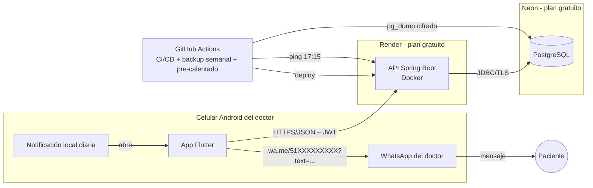
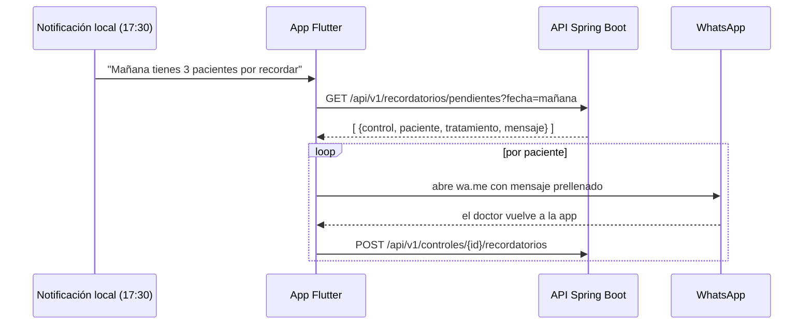

# 04 · Arquitectura

## 1. Vista general



### Flujo diario del recordatorio (Opción C)



La notificación es local (`flutter_local_notifications`) y solo **avisa**; los datos se piden al abrir la app.
Así no dependemos de que el servidor esté despierto para avisar.

## 2. Backend — Spring Boot

| Elemento | Elección |
|---|---|
| Lenguaje / runtime | Java 21 LTS (confirmar última versión estable al iniciar) |
| Framework | Spring Boot (última estable: Web, Validation, Data JPA, Security, Actuator) |
| BD / migraciones | PostgreSQL + Flyway |
| Auth | Spring Security + JWT (access 15 min, refresh 30 días, rotación) |
| Documentación API | springdoc-openapi (Swagger UI solo en dev) |
| Mapeo | MapStruct |
| Pruebas | JUnit 5, Mockito, AssertJ, MockMvc, **Testcontainers** (PostgreSQL real) |
| Calidad | JaCoCo, Spotless (formato), ArchUnit (reglas de capas) |
| Build | Gradle (Kotlin DSL) |

### Estructura por módulo (package-by-feature + capas)

```
backend/src/main/java/pe/gerenzdent/
├── shared/            # errores, auditoría, config, seguridad, utilidades de fecha (America/Lima)
├── auth/
├── paciente/
│   ├── api/           # Controller, DTOs request/response
│   ├── application/   # casos de uso (servicios)
│   ├── domain/        # entidades, reglas, puertos (interfaces)
│   └── infrastructure/# repositorios JPA
├── tratamiento/
├── plan/              # plan_tratamiento
├── control/
├── cuenta/            # cargos + pagos + cálculo de saldo
└── recordatorio/
    ├── domain/NotificationProvider.java   # puerto
    └── infrastructure/
        ├── WhatsAppLinkProvider.java      # Opción C (hoy): arma el texto y el enlace wa.me
        └── (futuro) WhatsAppCloudApiProvider.java
```

Regla (verificada con ArchUnit): `domain` no depende de Spring ni de `infrastructure`.

### Endpoints principales (`/api/v1`)

| Método | Ruta | Descripción |
|---|---|---|
| POST | `/auth/login`, `/auth/refresh`, `/auth/logout` | Sesión |
| GET/POST/PUT | `/pacientes`, `/pacientes/{id}` | CRUD + `?q=` búsqueda |
| PATCH | `/pacientes/{id}/archivar` | Archivar |
| GET | `/pacientes/{id}/resumen` | Ficha: datos, próximo control, historial, saldo |
| GET/POST/PUT | `/tratamientos` | Catálogo |
| POST | `/controles` | Crea control (y plan si no existe) |
| PATCH | `/controles/{id}/estado` | Cambia estado (valida transiciones) |
| PATCH | `/controles/{id}/fecha` | Reprograma |
| GET | `/recordatorios/pendientes?fecha=` | Lista de mañana con mensaje listo |
| GET | `/controles/vencidos` | Seguimiento |
| POST | `/controles/{id}/recordatorios` | Registra envío |
| POST | `/planes/{id}/pagos` · PATCH `/pagos/{id}/anular` | Pagos |
| POST/PUT | `/planes/{id}/cargos` · PATCH `/cargos/{id}/anular` | Cargos manuales / ajuste de monto |
| GET | `/deudas` | Pacientes con saldo > 0 y total |
| GET | `/actuator/health` | Salud (para el ping) |

Errores con formato estándar **RFC 9457 (Problem Details)**.

## 3. App móvil — Flutter

| Elemento | Elección |
|---|---|
| Estado | Riverpod |
| Navegación | go_router |
| HTTP | dio (interceptor JWT + reintentos) |
| Modelos | Clases inmutables escritas a mano con `fromJson`/`toJson` (sin generación de código: build más simple; se reevalúa si los modelos crecen) |
| Almacenamiento seguro | flutter_secure_storage |
| Notificación diaria | flutter_local_notifications + timezone |
| Abrir WhatsApp | url_launcher (`https://wa.me/<num>?text=<texto codificado>`) |
| Contactos | flutter_contacts (importar número, HU-07) |
| Fechas / moneda | intl (es_PE, PEN) |
| Pruebas | flutter_test, mocktail, integration_test |

```
mobile/lib/
├── core/        # tema (colores de marca), router, cliente http, errores, widgets comunes
└── features/
    ├── auth/ ├── inicio/ ├── pacientes/ ├── tratamientos/
    ├── controles/ ├── recordatorios/ └── pagos/
        ├── data/          # api, dto, repositorio
        ├── domain/        # modelos
        └── presentation/  # pantallas, widgets, providers
```

## 4. Repositorio (monorepo)

```
GerenzDent/
├── backend/
├── mobile/
├── docs/            # planificación, ADR, branding, manual de usuario
├── .github/workflows/
└── README.md
```

## 5. Decisiones de arquitectura (ADR)

### ADR-001 · Envío de WhatsApp semiautomático (Opción C)
- **Decisión:** la app arma el mensaje y abre WhatsApp con `wa.me`; el doctor presiona enviar.
- **Motivo:** S/ 0, sin riesgo de bloqueo del número personal, funciona desde el día 1.
- **Consecuencia:** no hay envío desatendido. Se mitiga con la notificación diaria y una lista que se envía
  en segundos. El puerto `NotificationProvider` permite migrar a WhatsApp Cloud API sin tocar el dominio.

### ADR-002 · API propia en Spring Boot + PostgreSQL (Neon)
- **Decisión:** Spring Boot en Render (Docker) y PostgreSQL en Neon.
- **Motivo:** control total, buen valor de portafolio, Neon no expira (la BD gratuita de Render sí expira a los 30 días).
- **Consecuencia:** más código que un BaaS; lo compensamos con una estructura modular clara.

### ADR-003 · Arranque en frío de Render
- **Problema:** Render gratis duerme el servicio sin tráfico; Spring Boot puede tardar 30–60 s en despertar.
- **Mitigación:** (1) GitHub Actions hace un ping a `/actuator/health` ~15 min antes de la hora de la
  notificación; (2) la app muestra "Conectando con el consultorio…" y reintenta; (3) JVM ajustada a 512 MB
  (`-XX:MaxRAMPercentage=75`, lazy init donde no afecte).
- **No** se mantendrá despierto 24/7 con pings constantes (consume las horas gratuitas y no es necesario).

### ADR-004 · Notificación local en vez de push (FCM)
- **Decisión:** la notificación diaria se programa en el teléfono.
- **Motivo:** no depende del servidor, no requiere Firebase, cero costo. Un solo usuario y un solo dispositivo.

### ADR-006 · Autenticación con JWT + refresh token rotativo (iteración 1)
- **Decisión:** access token JWT HS256 de 15 min (Spring Security Resource Server) y refresh token opaco de
  30 días, de un solo uso. En la BD solo se guarda su hash SHA-256. Reutilizar un refresh token ya usado
  cierra todas las sesiones (posible robo).
- **Usuario único:** no hay registro público. El usuario del doctor se crea en el primer arranque desde
  `ADMIN_EMAIL` / `ADMIN_PASSWORD` (variables de entorno). `JWT_SECRET` es obligatorio: sin él la API no arranca.
- **App:** los tokens van en `flutter_secure_storage` (Keystore). Un interceptor renueva la sesión ante un 401
  una sola vez y reintenta; si no puede, lleva al login. La sesión se restaura sin red al abrir la app.
- **Bloqueo:** 5 intentos fallidos → 15 min (HTTP 429 con `Retry-After`). Mismo mensaje para correo
  inexistente o clave errada.

### ADR-005 · Online-first
- **Decisión:** sin base de datos local en el MVP; solo caché en memoria.
- **Motivo:** hay internet en el consultorio; evita la complejidad de sincronización. Revisable si aparece la necesidad.

## 6. Seguridad y privacidad

- HTTPS de extremo a extremo (Render y Neon lo dan por defecto).
- Secretos (JWT, URL de BD) solo como variables de entorno; nunca en el repositorio.
- Datos personales: no se registran en logs; el número va en el texto de `wa.me` solo en el dispositivo.
- Rate limiting del login (Bucket4j o un filtro simple).
- Backup semanal: `pg_dump` cifrado con GPG, guardado como artefacto privado (retención de 4 semanas).
- Consentimiento: campo `consiente_whatsapp` por paciente.
- Repositorio público para portafolio → **sin datos reales**, solo datos de ejemplo en semillas de desarrollo.
