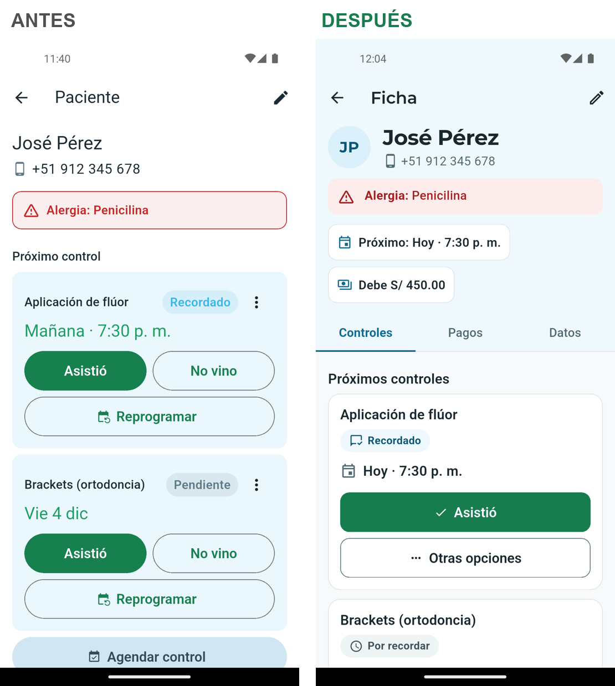
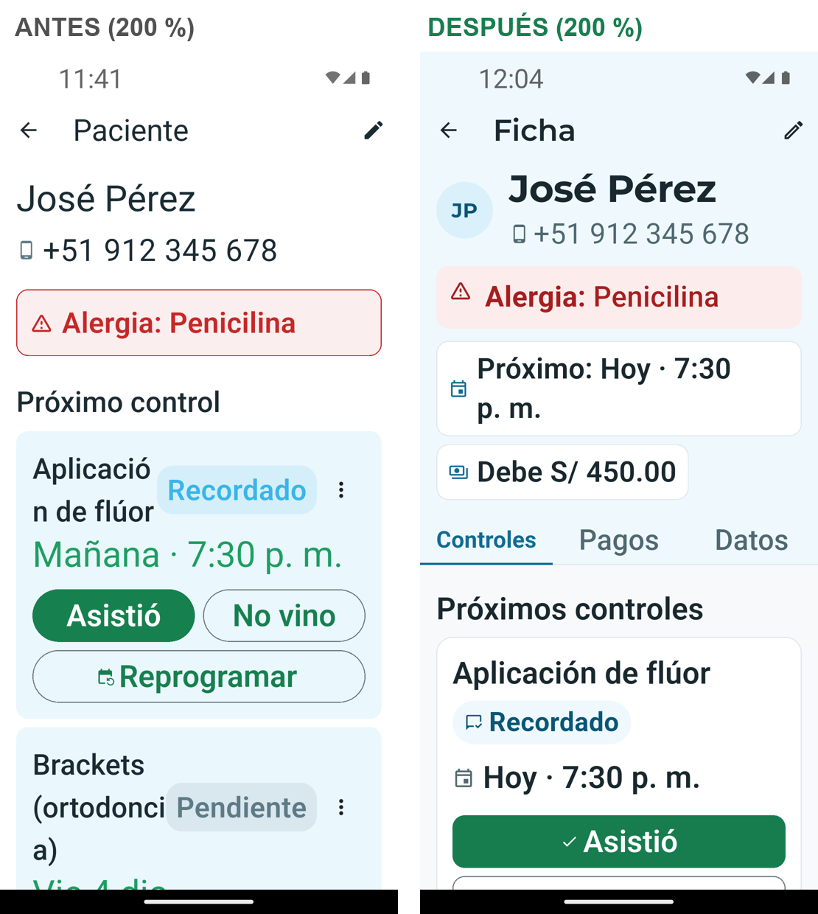

# Rediseño de interfaz · Fase 2: Sistema de diseño y pantalla piloto

Fecha: 2026-11-05 · Rama: `rediseno/ui-fase-1` · Piloto: **ficha del paciente**

Código: tokens en [`mobile/lib/core/theme/tokens.dart`](../../mobile/lib/core/theme/tokens.dart), tema en
[`app_theme.dart`](../../mobile/lib/core/theme/app_theme.dart) (`AppTheme.nuevo`) y componentes en
[`mobile/lib/core/ui/componentes.dart`](../../mobile/lib/core/ui/componentes.dart).
Por ahora **solo la ficha** usa el tema nuevo (envuelta en `Theme(AppTheme.nuevo)`); el resto de la app sigue
igual hasta la Fase 3.

## Dirección

**"Consultorio claro"**: fondo blanco levemente teñido de celeste, superficies blancas con borde fino, el
celeste de marca como estructura (cabecera, pestañas, enlaces) y el verde **solo** en la acción principal.
Montserrat (la letra del logo) solo en títulos, para que la app se sienta de GERENZ DENT y no una plantilla;
el resto en Roboto, la letra del sistema, por legibilidad.

Fuentes de criterio: `ui-ux-pro-max` (rubro salud: tipografía hiperlegible, evitar estilos de bajo contraste
como neumorfismo, checklist de entrega), `design-system` (tokens en 3 capas), `emil-design-eng` y
`apple-design` (una acción principal, retroalimentación inmediata, movimiento < 300 ms y respeto a "reducir
movimiento"), e `impeccable` (piso de calidad: nada de tarjetas anidadas, estados con ícono y texto).

---

## 1. Color

### Primitivos (derivados de los 3 colores)

| Escala | 50 | 100 | 200 | 500 (base) | 600 | 700 | 800 | 900 |
|---|---|---|---|---|---|---|---|---|
| Celeste | `#EFF9FD` | `#DAF1FB` | `#B6E3F6` | **`#3BB5E8`** | `#1985B3` | `#106C93` | `#0A5676` | `#073E55` |
| Verde | `#EEF9F4` | `#D9F2E7` | — | **`#22B573`** | `#1B925D` | `#177D4F` | `#13633F` | `#0D452C` |
| Neutro (teñido de celeste) | `#F7F9FB` | `#EFF4F5` | `#E0E8EB` | `#657C86` | `#506871` | `#3D535C` | `#283B43` | `#19282E` |

**Funcionales (aprobados en la Fase 1, no son de marca):** rojo `#FDECEC` / `#A61F1F` (error, alergia,
"No vino") y ámbar `#FFF6E0` / `#8F5A00` / `#6E4500` (vencido, deuda pendiente). Siempre con ícono y texto.

### Semánticos

| Token | Valor | Uso |
|---|---|---|
| `fondo` | neutro-50 | Fondo de pantalla (60 %) |
| `superficie` | blanco | Tarjetas, hojas, diálogos |
| `superficieMarca` | celeste-50 | Cabecera de la ficha y barra superior |
| `texto` | neutro-900 | Texto principal |
| `textoSecundario` | neutro-600 | Detalles, fechas, etiquetas |
| `textoMarca` / `marcaFuerte` | celeste-700 | Pestaña activa, enlaces, íconos de marca (30 %) |
| `accion` | verde-700 | Botón principal con texto blanco (10 %) |
| `avance` | verde-600 | Barra de lo pagado |
| `borde` | neutro-200 | Borde decorativo de tarjetas |
| `bordeControl` | neutro-500 | Borde de campos y botones secundarios |
| `error` | rojo-700 | Errores |

### Contraste (WCAG 2.2 AA), verificado

| Combinación | Ratio | Mínimo | Resultado |
|---|---|---|---|
| Texto neutro-900 / blanco | 15.17:1 | 4.5 | Cumple |
| Texto neutro-900 / fondo neutro-50 | 14.37:1 | 4.5 | Cumple |
| Secundario neutro-600 / blanco | 5.90:1 | 4.5 | Cumple |
| Secundario neutro-600 / neutro-50 | 5.59:1 | 4.5 | Cumple |
| Secundario neutro-600 / celeste-50 (cabecera) | 5.52:1 | 4.5 | Cumple |
| Borde de control neutro-500 / blanco | 4.39:1 | 3 | Cumple |
| Celeste-700 (pestaña, enlace) / blanco | 5.85:1 | 4.5 | Cumple |
| Celeste-800 / celeste-50 (chip Recordado) | 7.54:1 | 4.5 | Cumple |
| Celeste-800 / celeste-100 (iniciales) | 6.89:1 | 4.5 | Cumple |
| Blanco / verde-700 (botón principal) | 5.14:1 | 4.5 | Cumple |
| Verde-800 / verde-50 (chips Confirmó, Asistió, Pagado) | 6.76:1 | 4.5 | Cumple |
| Verde-600 (barra) / neutro-100 (pista) | 3.56:1 | 3 | Cumple |
| Ámbar-800 / ámbar-50 (chips Vencido, Debe) | 7.76:1 | 4.5 | Cumple |
| Ámbar-700 / blanco ("Vencido hace…") | 5.78:1 | 4.5 | Cumple |
| Rojo-700 / rojo-50 (alergia, No vino) | 6.48:1 | 4.5 | Cumple |
| Neutro-700 / neutro-100 (chips Por recordar, Cancelado) | 7.31:1 | 4.5 | Cumple |
| Texto neutro-900 / celeste-500 (si se usa el celeste puro de fondo) | 6.47:1 | 4.5 | Cumple |
| Texto neutro-900 / verde-500 (si se usa el verde puro de fondo) | 5.72:1 | 4.5 | Cumple |

**Aviso:** el celeste `#3BB5E8` y el verde `#22B573` puros **no** sirven para texto ni íconos sobre blanco
(2.34:1 y 2.65:1). En su lugar se usan sus tonos 700/800; los puros quedan para superficies con texto oscuro.

## 2. Estados (siempre ícono + texto + tono)

| Estado | Texto | Ícono | Tono |
|---|---|---|---|
| Cita pendiente de recordar | Por recordar | reloj | neutro |
| Recordada | Recordado | chat leído | celeste |
| Confirmada | Confirmó | pulgar arriba | verde |
| Atendida | Asistió | check en círculo | verde |
| Faltó | No vino | persona tachada | rojo |
| Cancelada | Cancelado | prohibido | neutro |
| Vencida (ya pasó la fecha) | Vencido | calendario tachado | ámbar |
| Pago pendiente | Debe S/ … | reloj | ámbar |
| Pagado | Pagado por completo · Está al día | check en círculo | verde |
| Error / alergia | (mensaje) | advertencia / nube tachada | rojo |

## 3. Tipografía (5 tamaños)

| Rol | Tamaño | Fuente | Uso |
|---|---|---|---|
| Titular | 28 sp | Montserrat Bold | Nombre del paciente, montos totales |
| Título | 22 sp | Montserrat SemiBold | Barra superior, título de hojas y diálogos |
| Subtítulo | 18 sp | Roboto 600 | Títulos de sección y de tarjeta, botones, fecha |
| Cuerpo | 16 sp | Roboto 400 | Texto base (mínimo) |
| Etiqueta | 14 sp | Roboto 600–700 | Solo chips de estado y etiquetas cortas |

Montserrat se incluye en la app (SemiBold y Bold, licencia SIL OFL en
`mobile/assets/fonts/OFL-Montserrat.txt`). Se copió de la caché local de Flutter: **no se agregó ninguna
librería** ni se descargó nada.

## 4. Espaciado, radios, elevación y movimiento

- **Espaciado (4/8):** 4 · 8 · 12 · 16 · 24 · 32 · 48. Margen de pantalla: 16. Más espacio arriba de un
  título (24) que debajo (8).
- **Radios:** controles 12 · tarjetas 16 · hojas y diálogos 28 · chips en píldora.
- **Elevación:** plano. Las tarjetas se separan del fondo por el color (blanco sobre neutro-50) y un borde
  de 1 px; sin sombras salvo las de Material en hojas y el botón flotante.
- **Movimiento:** 120 ms (presionar), 200 ms (cambio de pestaña), 250 ms (entrar), curva ease-out fuerte.
  Si el sistema pide "quitar animaciones", el cambio de pestaña es instantáneo y los esqueletos no pulsan.
  Al tocar, el efecto ondulado de Android (convención de la plataforma).

## 5. Componentes base

| Componente | Especificación |
|---|---|
| Botón principal | Relleno verde-700, texto blanco 18/600, alto 52, radio 12. **Uno por vista.** |
| Botón secundario | Contorno neutro-500, texto neutro-900, alto 52 |
| Botón terciario | Solo texto celeste-700, ≥ 48 dp |
| Campo | Relleno blanco, borde neutro-500 (2 px celeste-700 al enfocar), etiqueta visible |
| Tarjeta | Blanca, borde neutro-200, radio 16, sin sombra. Nunca tarjeta dentro de tarjeta |
| Tarjeta de control | Tratamiento → chip de estado → fecha → **Asistió** (principal) → **Otras opciones**. Solo el control más cercano lleva el botón principal; los demás, la versión secundaria |
| Fila de historial | Tratamiento + día + chip de estado, separadas por divisores dentro de una tarjeta |
| Chip de estado | Píldora con ícono 18 + texto 14/700 sobre el tono del estado; TalkBack lee "Estado: …" |
| Aviso | Fondo del tono, ícono + texto 16; la alergia se anuncia a TalkBack |
| Pestañas | Texto 16, activa en celeste-700 con indicador; el texto se achica en vez de cortarse |
| Dato rápido | Botón blanco ≥ 48 dp en la cabecera (Próximo control, Deuda) que lleva a su pestaña |
| Estado vacío | Ícono + texto que explica + acción ("Agendar control") |
| Carga | Esqueletos con la forma del contenido (no un círculo girando) |
| Hoja de opciones | Reemplaza el menú ⋮: cada opción con nombre, explicación e ícono; la peligrosa en rojo |
| Barra de navegación, diálogos, avisos (snackbar) | Tema nuevo listo; se aplican en la Fase 3 |

---

## 6. Pantalla piloto: ficha del paciente

| Antes | Después | Principio |
|---|---|---|
| Una columna larga: controles, historial, deuda y datos apilados | Cabecera con lo esencial + pestañas **Controles · Pagos · Datos** | Agrupar lo relacionado; menos desplazamiento |
| 3 botones grandes por control + menú ⋮ (8 botones con 2 controles y 2 deudas) | **Asistió** como única acción principal; el resto en "Otras opciones" | Una acción principal por vista |
| Dos controles = dos "Asistió" verdes | Solo el control más cercano lleva el botón verde | Jerarquía clara |
| "El paciente confirmó" y "Cancelar control" escondidos en ⋮ | Hoja con las 4 opciones explicadas ("Cambiar fecha" en vez de "Reprogramar") | Reconocer antes que recordar; lenguaje simple |
| Estados en texto claro sin ícono (2.1–3.0:1) | Chips con ícono + texto ≥ 6.7:1 | Nada solo por color; WCAG AA |
| Historial con estado en letra de ~11 sp | Chip de 14/700 con ícono | Legibilidad |
| La deuda solo se veía al bajar | "Debe S/ 450.00" y "Próximo: Hoy · 7:30 p. m." en la cabecera, tocables | Lo más usado, a la vista |
| Todas las deudas en rojo | Ámbar para "debe"; rojo reservado para errores, alergias y "No vino" | Color con significado |
| "Cargos" / "Agregar" | "Cobros" / "Agregar cobro" / "Ver cobros y pagos" | Sin jerga |
| Spinner al cargar; la deuda desaparecía y su error no tenía "Reintentar" | Esqueletos; error con "Reintentar" | Cuatro estados |
| A 200 %: "Aplicació / n de flúor", "p. / m." | Nada se corta a mitad de palabra; "p. m." no se separa | Accesibilidad |

Más capturas: [controles](capturas/despues/03-ficha-controles.png) ·
[pagos y datos](capturas/despues/04-ficha-pagos-datos.png) ·
[otras opciones](capturas/despues/05-otras-opciones.png). Todas con datos ficticios.

### Verificación

- `flutter analyze`: sin problemas. `flutter test`: **96 pruebas pasan** (92 anteriores + 4 nuevas de la
  ficha). Se ajustaron 2 pruebas de la tarjeta de control porque "No vino" ahora está en "Otras opciones".
- Emulador Pixel 5 (API 34) con letra al 100 % y al 200 %.
- No cambió la lógica: las mismas llamadas a la API, rutas y flujos (Asistió → ¿pagó? → ¿agendar?).

### Pendiente para la Fase 3

- Aplicar el tema nuevo a toda la app (Inicio, Pacientes, Deudas, Ajustes, formularios y hojas).
- Rediseñar las hojas **Agendar control** y **Registrar pago** (más cortas, sin "+15 d").
- "Deshacer" tras "Asistió"/"No vino": la API no permite reabrir un control cerrado, así que requeriría un
  cambio en el backend. Hoy se mantiene la confirmación donde ya existía.
- Unificar la cadena de preguntas tras "Asistió" en una sola hoja (sin cambiar lo que se guarda).
- Retirar `AppColors` y el color del enum `EstadoControl` cuando ninguna pantalla los use.
